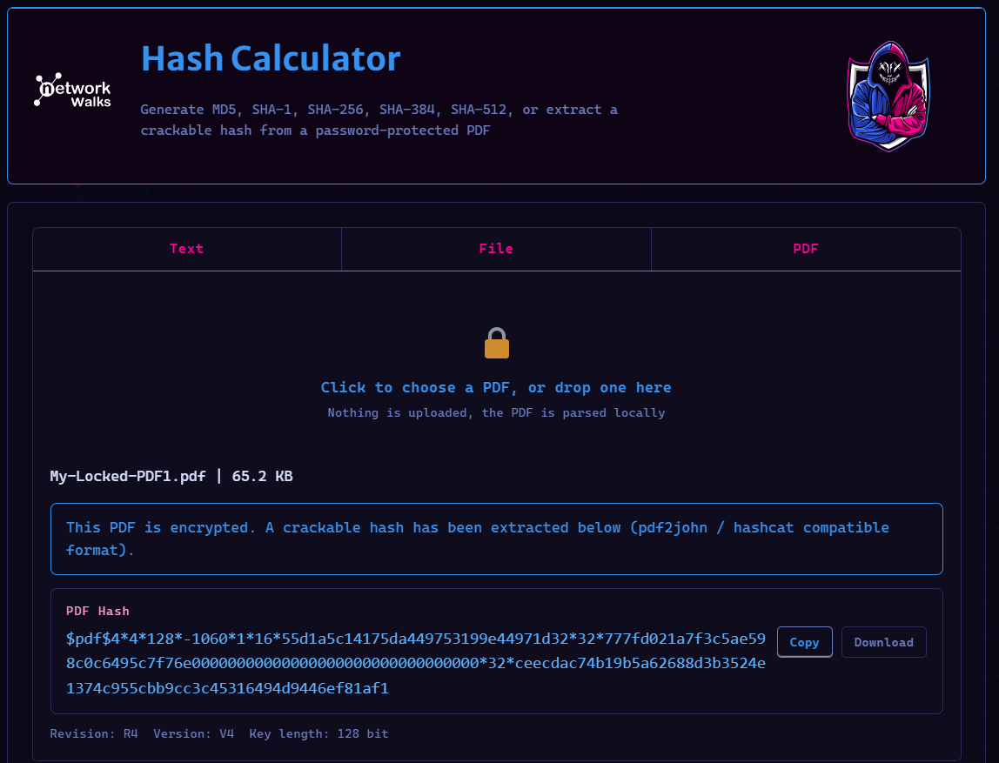
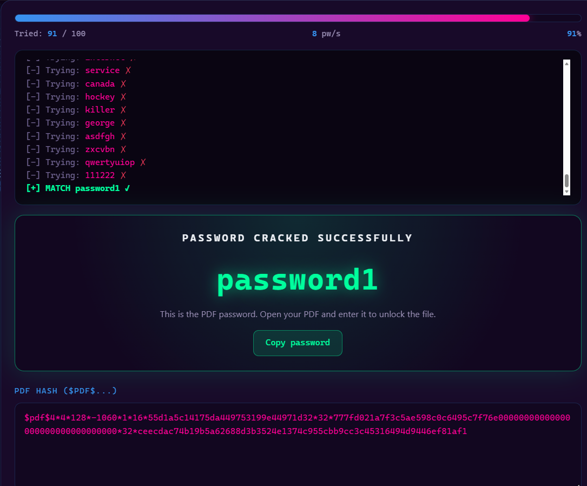
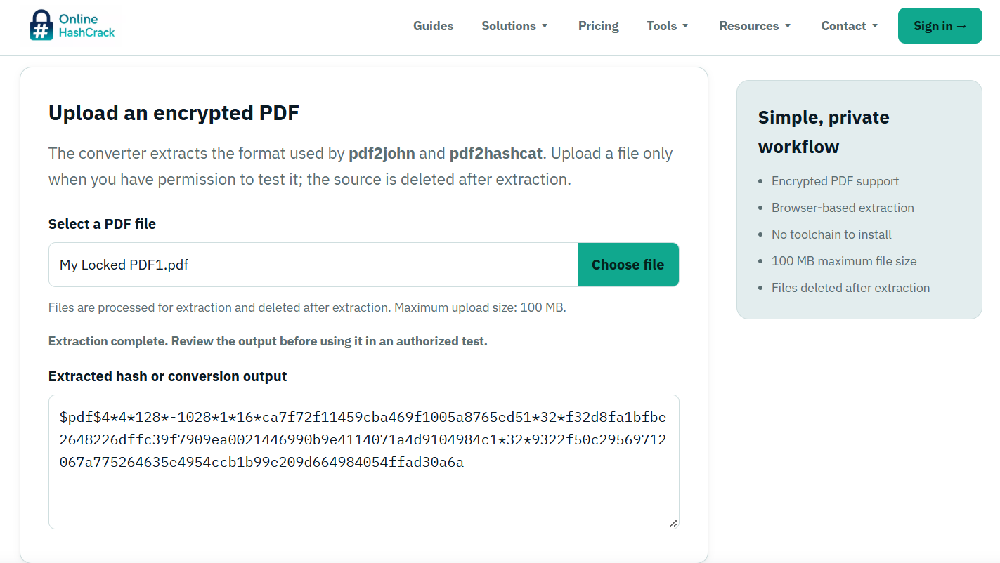
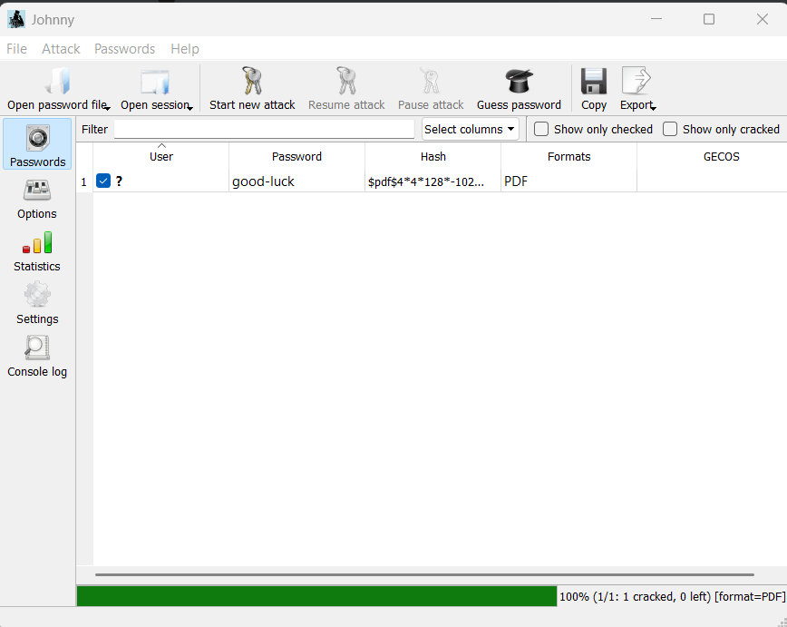
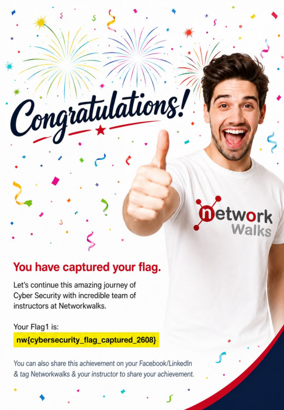
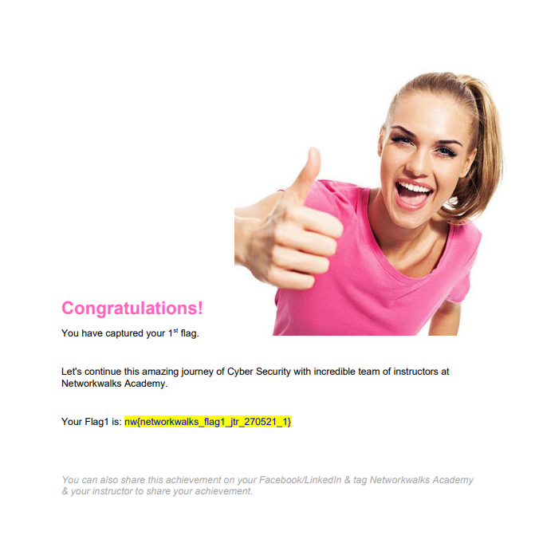

# NETWORKWALKS-B084-W3-PM1-2-PASSWORD-CRACKING
Cybersecurity and Ethical Hacking - PASSWORD CRACKING

# 🔓 Password Cracking with Networkwalks Tools & John the Ripper

**Week 3 Project | Cybersecurity Internship Program - Networkwalks (Batch B082)**

* * *

## 📌 Project Overview

This repository documents Week 3 of my Cybersecurity Internship, focusing on password cracking methodologies. The objective was to understand how passwords are stored in files, how hashes are extracted, and how dictionary attacks are used to recover the plaintext password.

I used two different approaches to crack a password-protected PDF file (`My Locked PDF1.pdf`):
1.  **Web-based Tools:** Networkwalks Hash Calculator & Password Cracker.
2.  **Local GUI Tool:** John the Ripper (Johnny).

**⚠️ Disclaimer:** All activities were performed on a test file provided by Networkwalks for educational purposes. This demonstrates how weak passwords are vulnerable to dictionary attacks.

* * *

## 🧠 Theory: Hashing vs. Encryption

As part of this lab, I learned the critical difference between encryption and hashing:
*   **Encryption** is a two-way function. Data is scrambled with a key, and it can be unscrambled (decrypted) if you have the correct key.
*   **Hashing** is a one-way function. It takes plain text and turns it into a unique string of characters (a hash). You cannot "decrypt" a hash. You can only guess the password, hash the guess, and see if it matches the original hash.

* * *

## 🛠️ Tools Used

| Tool | Type | Purpose |
| :--- | :--- | :--- |
| **Networkwalks Hash Calculator** | Web Tool | To extract the crackable `$pdf$` hash from the locked PDF. |
| **Networkwalks Password Cracker** | Web Tool | To perform a dictionary attack against the extracted hash. |
| **OnlineHashCrack** | Web Tool | Used to extract the hash for the JTR exercise. |
| **John the Ripper (Johnny GUI)** | Local Software | A powerful, open-source password cracker used via a graphical interface. |

* * *

## 🚀 Lab Execution (Activities Performed)

### Task 1: Cracking with Networkwalks Tools (W3-PM2)
1.  Downloaded the encrypted PDF file (`My Locked PDF1.pdf`).
2.  Used the **Networkwalks Hash Calculator** to extract the `$pdf$` hash format. 
3.  Copied the hash and pasted it into the **Networkwalks Password Cracker**.
4.  Ran the dictionary attack using the built-in 100-word list.
5.  **Result:** The tool successfully cracked the password in seconds. The password was `password1`.

### Task 2: Cracking with John the Ripper / Johnny (W3-PM1)
1.  Installed **Johnny** (the GUI for John the Ripper).
2.  Used **OnlineHashCrack** to extract the hash from the same PDF and saved it as `hash1.txt`.
3.  Opened Johnny, pointed it to the `hash1.txt` file, and configured it to use the `john.exe` executable.
4.  Started the attack. 
5.  **Result:** Johnny successfully cracked the hash, revealing the same password: `password1`.
6.  Opened the PDF using the cracked password to reveal the "Congratulations!" flag.

* * *

## 🚨 Risk Analysis & Impact

| Finding | Observation | Potential Impact | Risk Level |
| :--- | :--- | :--- | :--- |
| **Weak Password Policy** | The password `password1` was cracked almost instantly using a basic dictionary attack. | Attackers can use automated tools to compromise accounts or encrypted files, leading to data breaches. | **High** |
| **Use of Common Words** | The password was a common dictionary word with a single number appended. | Easily guessed by cracking tools that use rule-based mutations. | **High** |

* * *

## 🛡️ Recommendations

1.  **Enforce Strong Password Policies:** Require a minimum of 12-14 characters, mixing uppercase, lowercase, numbers, and special symbols.
2.  **Avoid Dictionary Words:** Passwords should not contain common words, names, or predictable patterns (like `password1` or `Summer2026!`).
3.  **Use Password Managers:** Encourage the use of password managers to generate and store complex, unique passwords.
4.  **Implement Multi-Factor Authentication (MFA):** Even if a password is cracked, MFA adds an essential layer of defense.

* * *

## 📸 Evidences Collected

**1. Networkwalks Hash Calculator (PDF Hash Extraction):**

**2. Networkwalks Password Cracker (Successful Crack):**

**3. Johnny / JTR Hash Extraction:**

**4. Johnny GUI (Successful Crack):**

**5. Unlocked PDF (The "Flag"):**

**6. Unlocked PDF (NW flag):**

* * *

## 👤 Author
**Lehohonolo Mabesele**  
Cybersecurity Intern  
LinkedIn: www.linkedin.com/in/lehlohonolo-mabesele-905a8b35a

## 📌 Project Information
**Program Name:** Cybersecurity program at Networkwalks | **Week:** 03 | 
